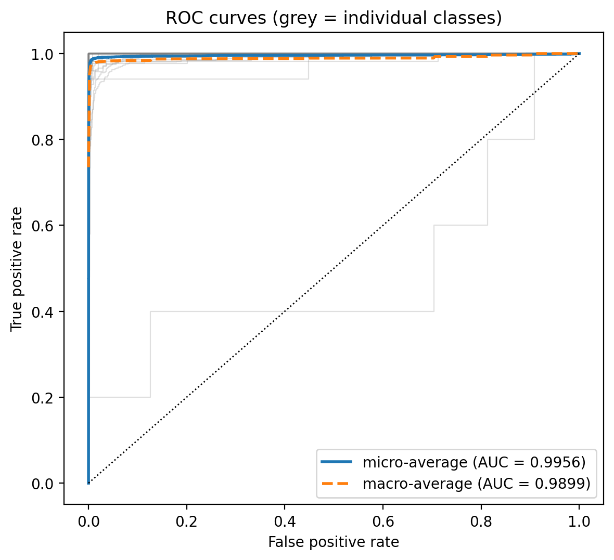
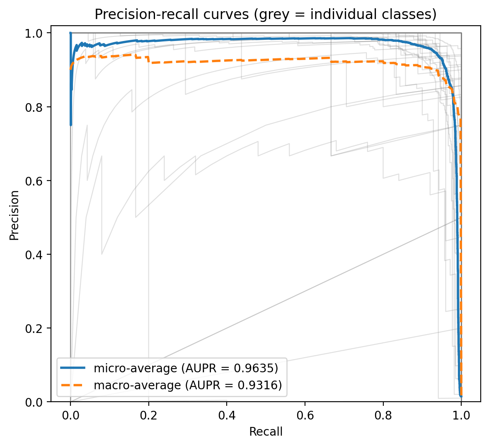
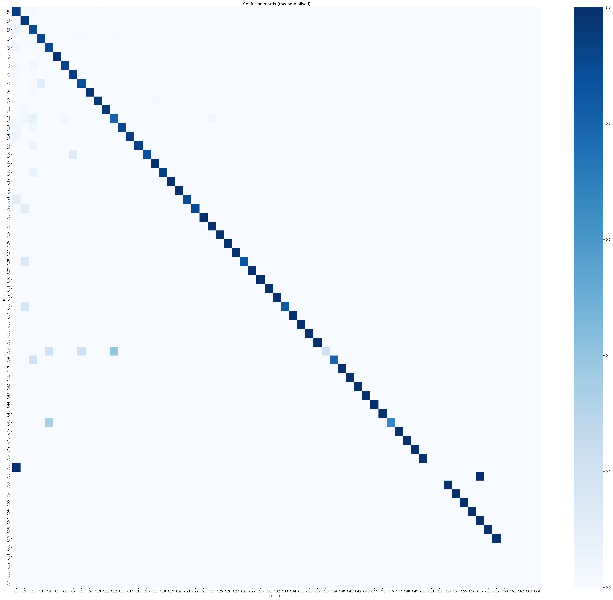
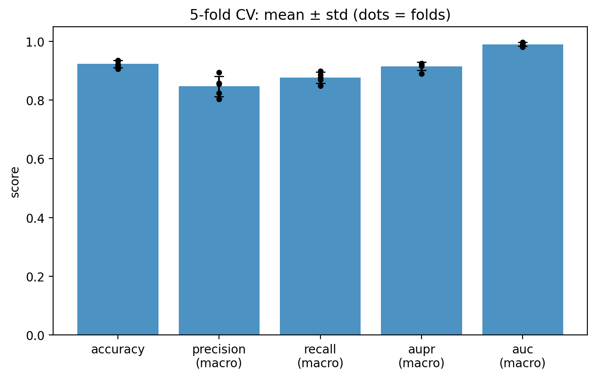

# Multi-View Attention DDI Prediction with ComplEx Knowledge-Graph Embeddings

Predicting the **type** of interaction between two drugs (drug–drug interaction, DDI) by combining five views of each drug with an attention-based deep network. One of the five views is a knowledge-graph embedding learned with **ComplEx** on a subgraph of DRKG.

**Live demo:** [Try it on Hugging Face Spaces](https://huggingface.co/spaces/rawanMahmoud/ddi-type-predictor)

The project is inspired by *Predicting drug–drug interactions based on multi-view and multichannel attention deep learning* (Huang, Chen & Lan, 2023). It uses the same dataset size and evaluation protocol (572 drugs, 37,264 pairs, 65 interaction types, five-fold cross-validation) but a different architecture, so it is **not an exact reproduction** (see [Differences from the paper](#differences-from-the-paper)).

## Repository structure

```
README.md
requirements.txt
app.py                      Gradio demo
src/mmadl.py                the model class (PyTorch only), used by the demo
src/predict.py              loads the saved model and predicts for a drug pair
models/                     model.pt, meta.json, known_pairs.npz (created by train_final)
notebooks/
  embedding-using-complex-model.ipynb
  mmadl-model.ipynb
results/                    figures, metrics.json, cv_summary.csv
```

| Notebook | What it does |
|---|---|
| `embedding-using-complex-model.ipynb` | Filters DRKG to a drug-centred subgraph, trains a ComplEx model, and stores a 512-d embedding for each of the 572 drugs. |
| `mmadl-model.ipynb` | Builds the five drug views, runs five-fold cross-validation and a final train/validation/test run, evaluates the model and exports it for the demo. |

Run them in this order. The first notebook produces `drug_info_with_embedding_drkg_complex.pkl`, which the second one reads.

```
DRKG triples ──► [notebook 1] ComplEx ──► 512-d drug embedding ─┐
DrugBank targets / enzymes / pathways / SMILES ──► Jaccard views ┼─► [notebook 2] attention model ──► DDI type
                                                                 ┘
```

## Notebook 1 – ComplEx embeddings from DRKG

1. **Filter DRKG** (5,874,261 triples) to entities of six types: Compound, Side Effect, ATC, Pharmacologic Class, Disease, Gene. A triple is kept only if its head or tail is one of the 572 study drugs. Two compound–compound relations are removed (`DRUGBANK::ddi-interactor-in::Compound:Compound`, the DrugBank DDI edges, and `Hetionet::CrC::Compound:Compound`, compound resemblance), so the embeddings are not built from drug–drug links. Result: **134,150 triples, 16,851 entities, 47 relations**.
2. **Train ComplEx** (PyTorch, written from scratch): 256 complex dimensions, Adam (lr 0.005), 50 epochs, batch size 1024, 5 random negatives per positive (head or tail corruption), softplus loss with N3 regularisation (weight 1e-3).
3. **Export**: each drug's vector is the real part concatenated with the imaginary part, giving **512 values**. Drugs with no embedding get zeros.

## Notebook 2 – Multi-view attention classifier

### Drug views (572 drugs)

| View | Source | Raw features |
|---|---|---|
| Structure | SMILES → Morgan fingerprint (radius 2) | 1,024 bits |
| Target | DrugBank | 1,162 binary |
| Enzyme | DrugBank | 202 binary |
| Pathway | KEGG pathway IDs via DrugBank | 957 binary |
| Knowledge graph | ComplEx on the DRKG subgraph (notebook 1) | 512 floats |

For the first four views the binary vectors are turned into a 572 × 572 **Jaccard similarity matrix** (|A ∩ B| / |A ∪ B|); each drug is represented by its row, i.e. its similarity to every drug. The knowledge-graph view is standardised and used directly.

### Labels

Each of the 37,264 interactions is a DrugBank sentence such as "The metabolism of *X* can be decreased when combined with *Y*". Drug names are replaced by `name`, and the sentence is mapped to one of **65 event types**. All 65 types are kept. Some are rare (11 types have fewer than 10 pairs), so stratified splits fall back to random splits for those classes.

### Model

- One encoder per view (`Linear → LayerNorm → GELU → Dropout`) maps each view to 256 dimensions. The encoders are shared between the two drugs of a pair.
- A learned view embedding is added, then **4-head self-attention** over the five view tokens, with residual connections, LayerNorm and a feed-forward block.
- The five attended tokens are concatenated and projected to one 256-d vector per drug (`z`).
- A pair is represented as `[z1, z2, z1 ⊙ z2]` and passed to an MLP (768 → 1024 → 512 → 65).
- Random **view dropout** (10%) during training makes the model robust to a missing view.

### Training

- AdamW (lr 1e-3, weight decay 1e-2), label smoothing 0.05, gradient clipping 1.0, `ReduceLROnPlateau` on validation macro-F1.
- Weighted sampling to favour rare classes (`sampler_power=0.5`).
- Early stopping on validation macro-F1 (patience 10).
- **Five-fold cross-validation**: each fold uses 20% of the pairs as the test set; 10% of the remaining pairs are held out for early stopping. The test fold is used only once.
- A **final run** on a stratified 72/18/10 train/validation/test split produces the saved model and the figures.

## Results

### Five-fold cross-validation (65 types, mean ± std over folds)

| Metric | This repo | Paper (Table 3) |
|---|---|---|
| Accuracy | 0.9227 ± 0.0121 | 0.9305 |
| Precision | 0.8464 ± 0.0349 (macro) | 0.8761 |
| Recall | 0.8760 ± 0.0188 (macro) | 0.8568 |
| AUPR | 0.9651 ± 0.0046 (micro) / 0.9147 ± 0.0140 (macro) | 0.9594 |
| AUC | 0.9973 ± 0.0011 (micro) / 0.9899 ± 0.0061 (macro) | 0.9980 |
| F1 (macro) | 0.8532 ± 0.0261 | not reported |
| MCC | 0.9077 ± 0.0143 | not reported |

**Reading the table:** performance is **comparable** to the paper, not better. Accuracy and precision are slightly lower (the accuracy gap is within one standard deviation), recall is higher, and AUC and AUPR depend on how they are averaged: the paper does not say whether its values are micro or macro averages, so both are shown. Differences of this size, with the fold-to-fold variation above, should not be read as one method beating the other.

### Single held-out split (final model)

| Metric | Value |
|---|---|
| Accuracy | 0.9388 |
| Precision / Recall / F1 (macro) | 0.8886 / 0.9147 / 0.8966 |
| MCC | 0.9267 |
| AUC (macro / micro) | 0.9899 / 0.9956 |
| AUPR (macro / micro) | 0.9316 / 0.9635 |

This is one split, so it is noisier than the cross-validation numbers above; use the cross-validation table for any comparison.

For reference, an earlier run that kept only the 23 interaction types with at least 100 pairs reached 0.9418 accuracy on a single test split.

### Figures






Training curves, per-class F1/AUPR and a t-SNE of the pair representations are also in `results/`. Per-class numbers (including the weakest, rare classes) are in `results/per_class_metrics.csv`.

## Differences from the paper

| | Paper | This repo |
|---|---|---|
| Attention | Channel attention (global pooling → two FC layers → sigmoid → rescale) | Multi-head self-attention over view tokens with a feed-forward block |
| Pair features | Concatenated drug-pair Jaccard rows, then a single-layer encoder | Per-drug encoding, then `[z1, z2, z1 ⊙ z2]` |
| Structure view | 881 PubChem substructure bits | 1,024-bit Morgan fingerprint (RDKit) |
| Labels | 65 types | 65 types |
| Evaluation | Five-fold cross-validation | Five-fold cross-validation |
| DRKG subgraph | 450,412 triples, 58,251 entities | 134,150 triples, 16,851 entities |
| Optimiser | lr 0.0005, dropout 0.3 | AdamW lr 1e-3, dropout 0.3, label smoothing, scheduler |

## Demo

```bash
pip install -r requirements.txt
python app.py
```

`app.py` loads the files in `models/` and lets you pick two drugs; it returns the three most likely interaction types with probabilities. Drug A is the affected drug (swapping A and B can change the result). The app also says whether the chosen pair is part of the training data, in which case the output is not a test of generalisation. The model only knows the 572 drugs it was trained on.

Research demo only, **not medical advice**.

## Data

The datasets are **not included in this repository**.

| File read by the notebooks | What it is | Where it comes from |
|---|---|---|
| `drkg.tsv` | Full DRKG triples | [DRKG](https://github.com/gnn4dr/DRKG) |
| `updated_file1.csv` | 572 drugs: DrugBank ID, name, SMILES, targets, enzymes, pathways | [DrugBank (+ KEGG)](https://github.com/Liyu-gx/MMADL) |
| `df_interaction.xlsx` | 37,264 drug pairs with the DrugBank interaction sentence | [DrugBank](https://github.com/Liyu-gx/MMADL) |
| `df_event.xlsx` | The 65 interaction event templates | [derived from the above](https://github.com/Liyu-gx/MMADL) |

The notebooks read from Kaggle paths (`/kaggle/input/datasets/rawanmahmoudrm/<dataset>/…`). To run elsewhere, put the files in a local folder and change the paths in the first cell of each notebook.

**Licensing notes** (not legal advice):

- DrugBank data is generally licensed [CC BY-NC 4.0](https://creativecommons.org/licenses/by-nc/4.0/): attribution required, non-commercial use only. Check DrugBank's terms before redistributing any DrugBank-derived data. The saved model in `models/` contains similarity features derived from DrugBank, so treat it the same way.
- DRKG is released under Apache-2.0, but it integrates DrugBank, Hetionet, GNBR, STRING, IntAct and DGIdb, each with its own terms.

## Math background

- **ComplEx**: entities and relations are complex vectors; a triple (h, r, t) is scored by Re(⟨h, r, conj(t)⟩), which lets the model represent asymmetric relations. Training uses a logistic (softplus) loss with sampled negatives.
- **Jaccard similarity**: |A ∩ B| / |A ∪ B| between two binary feature sets.
- **Self-attention**: softmax(QKᵀ/√d)·V over the five view tokens, so each view can weigh the others.
- **Classification**: softmax over 65 classes with cross-entropy (label smoothing 0.05).
- **Metrics**: precision, recall and F1 (macro-averaged), MCC, AUC (area under the ROC curve) and AUPR (area under the precision–recall curve).

## Limitations and future work

- Pairs are split at random, so the same drug can appear in training and test. A split that holds out whole drugs would measure generalisation to unseen drugs.
- The ComplEx embeddings are used as features but are not evaluated on their own (no link-prediction metrics such as MRR or Hits@10).
- Rare interaction types (fewer than 10 pairs) have very few test examples, so their scores are unreliable; see `per_class_metrics.csv`.
- The Jaccard views have one value per drug in the dataset, so adding a new drug means recomputing them.
- The model is not compared to the paper's exact architecture on identical folds.

## References

- L. Huang, Q. Chen, W. Lan. *Predicting drug–drug interactions based on multi-view and multichannel attention deep learning.* Health Information Science and Systems 11, 50 (2023). https://doi.org/10.1007/s13755-023-00250-x
- T. Trouillon et al. *Complex embeddings for simple link prediction.* ICML 2016.
- V. N. Ioannidis et al. *DRKG – Drug Repurposing Knowledge Graph for Covid-19.* 2020. https://github.com/gnn4dr/DRKG
- D. S. Wishart et al. *DrugBank 5.0: a major update to the DrugBank database for 2018.* Nucleic Acids Research 46, D1074–D1082 (2018).
- RDKit: open-source cheminformatics. https://www.rdkit.org

## License

Copyright (c) 2026 Rawan Mahmoud. All rights reserved. The code, notebooks, trained model and demo are shared for viewing and evaluation only; see LICENSE. Third-party data and software (DrugBank, DRKG, KEGG, PyTorch, RDKit and others) keep their own licenses.